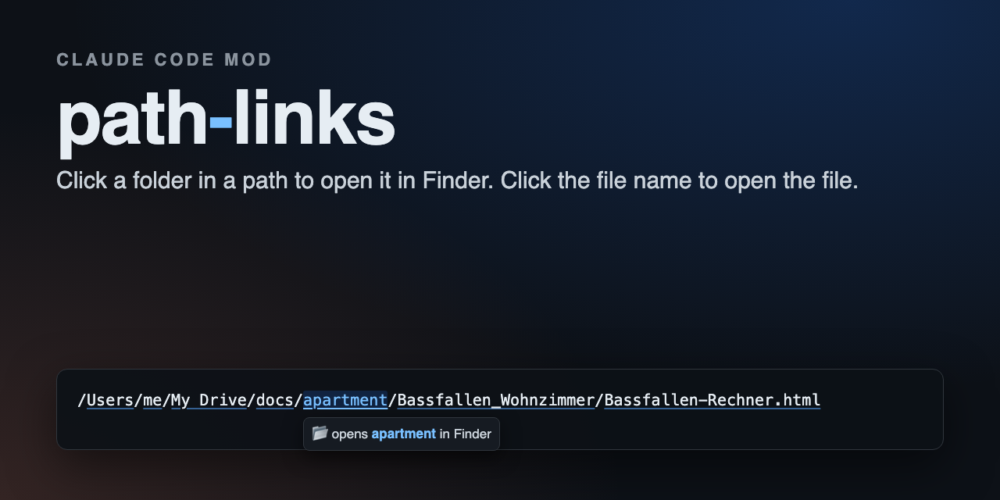
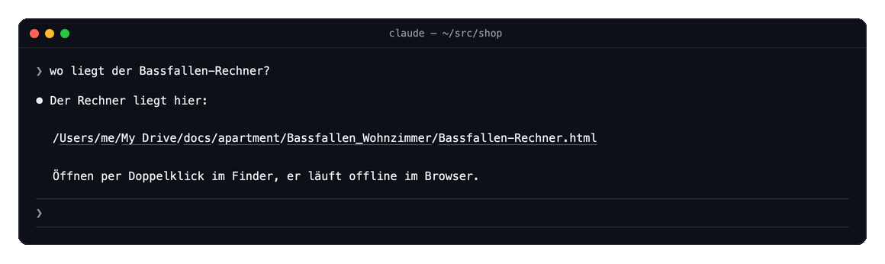
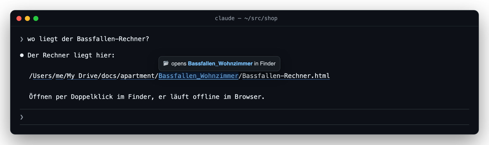
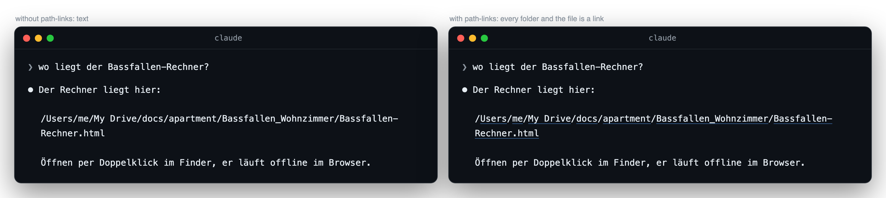
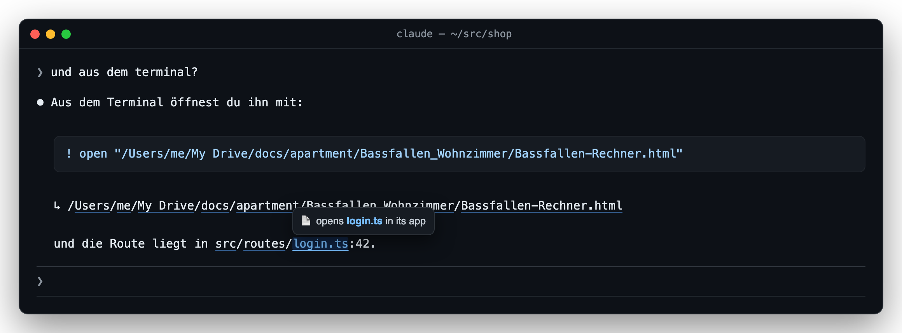
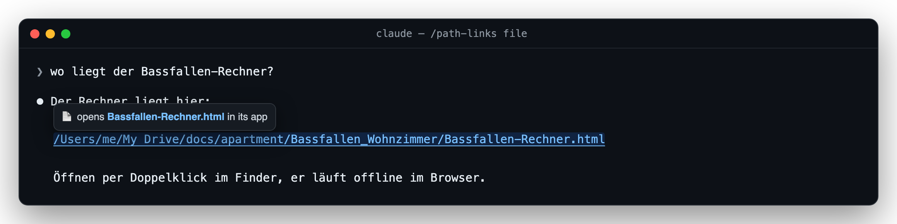

<div align="center">

<a href="https://github.com/pepperonas/path-links"></a>

# 🔗 path-links

**A Claude Code mod that turns every file path in Claude's replies into links — one per folder. Click a folder to open it in your file manager, click the file name to open the file.**

<p>
  <a href="#-install"></a>
  &nbsp;
  <a href="#-demo"></a>
</p>

<h3>👉 <code>/plugin marketplace add pepperonas/path-links</code> · <code>/plugin install path-links@pepperonas-path-links</code> — that's it.</h3>

[](CHANGELOG.md)
[](tests)
[](hooks)
[](hooks)

[](https://github.com/pepperonas/path-links/actions/workflows/ci.yml)
[](https://code.claude.com/docs/en/plugins/mods/overview)
[](#requirements)
[](https://www.typescriptlang.org)
[](package.json)
[](package.json)
[](#-how-it-works)
[](#requirements)
[](#-privacy)
[](#-testing)
[](CHANGELOG.md)
[](https://semver.org)
[](https://github.com/pepperonas/path-links/commits/main)
[](https://github.com/pepperonas/path-links/issues)
[](https://github.com/pepperonas/path-links)
[](https://github.com/pepperonas/path-links/stargazers)
[](https://github.com/pepperonas/path-links/forks)
[](#-contributing)
[](LICENSE)

[](https://www.paypal.com/donate/?business=martin.pfeffer@celox.io&currency_code=EUR&item_name=path-links)
[](https://g.page/r/CXgdRV3QysvxEBM/review)

</div>

---

> [!NOTE]
> **Nothing is changed but the drawing.** The reply Claude wrote stays exactly as it was (ctrl+o shows
> it); path-links only rewrites how the transcript *draws* it. It reads nothing but whether a path
> exists, makes no network call and starts no process — the click is your terminal's.

## 🎬 Demo



<sub>Every folder in the path is its own link, and so is the file. Point at one and your terminal shows where it goes; click it and it opens — a folder in Finder (or your file manager), a file in the app it belongs to.</sub>

## 📸 Screenshots



<sub>Hover any segment: <code>Bassfallen_Wohnzimmer</code> opens that folder, not the file next to it.</sub>



<sub>Before and after — the text is the same, character for character; only the links are new.</sub>



<sub>Code blocks stay copyable as written; the paths they name follow on a line of their own. Relative paths and <code>:line</code> suffixes work too.</sub>



<sub><code>/path-links file</code>: the whole path as one link, if you prefer it that way.</sub>

## ✨ Features

- **One link per folder** — click `docs` to open `docs`, click `Bassfallen_Wohnzimmer` to open that folder, click the file name to open the file. Folders open in Finder (or your Linux file manager), files in their default app.
- **Paths with spaces** — `My Drive`, `Main St. 24`: running text is matched word by word and the longest spelling that **exists** wins, so the sentence after a path is never swallowed.
- **Only real paths** — every candidate is checked against the file system first. Nothing that doesn't exist becomes a link, so there are no dead links and `and/or` stays text.
- **Absolute, `~/` and relative** — `hooks/register.tsx` resolves against the session's working directory; the spelling you see is kept as written.
- **`:42` and `:42:7`** — line suffixes stay as text after the file link.
- **Inline code** — `` `/etc/hosts` `` becomes the links (a link can't live inside a code span); inline code holding a whole command stays code and its paths follow on the next line.
- **Code blocks stay copyable** — a fenced block is never touched; the paths it names appear under it as `↳ …`, each once, three at most.
- **Links stay links** — existing markdown links, autolinks and `https://` URLs are never rewritten.
- **Cheap** — lookups are cached (a hit for a minute, a miss for five seconds) and capped per drawing; a reply without a `/` is passed through untouched.

## 📥 Install

### Requirements

- **Claude Code with mods** — mods are on by default in current releases; path-links is tested with **2.1.296**.
- **A terminal that opens OSC 8 hyperlinks** — iTerm2, Terminal.app, Ghostty, WezTerm, Kitty, VS Code's terminal, GNOME Terminal and most others. In iTerm2 and Terminal.app a link opens with **⌘-click**; in Claude Code's fullscreen mode a plain click does it.
- **macOS or Linux.** `file://` links open with `open` / `xdg-open`, which is your terminal's business, not the mod's.

### Option 1 — marketplace (recommended)

The repository is its own plugin marketplace. In Claude Code:

```
/plugin marketplace add pepperonas/path-links
/plugin install path-links@pepperonas-path-links
```

or from the shell:

```bash
claude plugin marketplace add pepperonas/path-links
claude plugin install path-links@pepperonas-path-links
```

Replies drawn after that carry the links. Update with `/plugin marketplace update pepperonas-path-links`, then `claude plugin update path-links@pepperonas-path-links`. Settings: `/plugin configure path-links@pepperonas-path-links` (every option has a default, so you can skip it).

### Option 2 — skills folder

Claude Code loads a plugin it finds in `~/.claude/skills/<name>` by itself, in every session:

```bash
git clone https://github.com/pepperonas/path-links ~/.claude/skills/path-links
```

Update with `git -C ~/.claude/skills/path-links pull`. If you also install it from the marketplace, the marketplace copy wins.

### Option 3 — one session

```bash
git clone https://github.com/pepperonas/path-links
claude --plugin-dir ./path-links
```

### Option 4 — desktop app and SDK hosts

Where you can't pass a flag, name the folder in `CLAUDE_CODE_PLUGIN_DIRS` — in your shell environment or in the `env` block of `~/.claude/settings.json`:

```json
{ "env": { "CLAUDE_CODE_PLUGIN_DIRS": "~/src/path-links" } }
```

## 🕹️ Usage

Nothing to do: ask Claude where something is, and the path in the answer is clickable. The command tunes it:

| Command | What it does |
| --- | --- |
| `/path-links` | Shows the current settings and this list |
| `/path-links segments` | Every folder and the file are links (default) |
| `/path-links file` | The whole path is one link, to the file |
| `/path-links off` | No links; replies are drawn as written |
| `/path-links blocks on\|off` | The `↳` line under code blocks and command-style inline code |
| `/path-links relative on\|off` | Link relative paths such as `src/routes/login.ts` |

Settings changed with the command are remembered across sessions.

## ⚙️ Configuration

`/plugin configure path-links@pepperonas-path-links` sets the defaults; the command above overrides them.

| Option | What it does | Default |
| --- | --- | --- |
| `mode` | `segments`: every folder and the file are links · `file`: the whole path is one link · `off` | `segments` |
| `codeBlocks` | Paths inside a code block get a clickable line under the block | on |
| `relative` | Link relative paths, resolved against the working directory | on |

## 🧠 How it works

Claude Code draws each block of an assistant reply through a `ui.render` event for the `AssistantMessage` component. path-links hooks it and hands the engine the same markdown with the paths turned into links:

```
/Users/me/My Drive/x.html
        ↓
/[Users](file:///Users/)/[me](file:///Users/me/)/[My Drive](file:///Users/me/My%20Drive/)/[x.html](file:///Users/me/My%20Drive/x.html)
```

Claude Code's own markdown renderer draws those as **OSC 8 hyperlinks** — the terminal shows the text unchanged and knows where each piece points. A click hands the `file://` URL to the system: a URL ending in `/` is a folder and opens in the file manager, anything else opens with its default app.

1. **Scan** (`hooks/paths.ts`, pure) — the markdown is split into code blocks, inline code, links/URLs and running text. Path candidates start at `/`, `~/`, `./` or `word/`; in running text a candidate may stretch over up to ten space-separated words, in quotes or inline code it is taken whole. Trailing punctuation, an unopened `)` and a `:line` suffix are peeled off.
2. **Look up** (`hooks/register.tsx` + `walk` in `hooks/paths.ts`) — every candidate is walked down from its trusted root with `$.fs.list`, one folder at a time, never through a symlink (see [Privacy](#-privacy)); at most 64 candidates per drawing, listings and answers cached. Whether a path is a file or a folder comes from the listing.
3. **Rewrite** (`hooks/paths.ts`) — the same scanner runs again with the answers and picks the longest spelling that exists. Each segment becomes `[name](file://…)`; labels are markdown-escaped (`Bassfallen\_Wohnzimmer`), URLs percent-encoded (spaces, umlauts, `#`, `?`, parentheses).

The stored message is never changed — only its drawing — so copying, `ctrl+o`, `/export` and the model's context all see the reply exactly as Claude wrote it.

## 🔒 Privacy

- **No network.** The mod makes no request of any kind.
- **No processes.** It never runs `open` itself; clicking is between you and your terminal.
- **Never touches network locations.** A lookup can reach the network through an automounter (`/net`, `/Network`, macOS's `/home`), a mounted share or a symlink to one — and reply text must never make your machine contact a host. So **no path from a reply is ever handed to `stat`**, which follows links. A lookup starts at a trusted root — your home folder, the working directory (unless it is `/`), or a local system folder (`/etc`, `/tmp`, `/usr`, `/opt`, `/Applications`, `/Library`, …) — and walks down **one directory listing at a time**; a listing names a symlink without following it, and a path that runs through a symlink is simply not linked. `/Volumes`, `/mnt`, `/media`, `/System/…` and everything outside the roots are never looked at. A listing slower than 300 ms counts as missing, so a stalled mount can't freeze the transcript.
- **Reads only metadata.** It asks whether a path exists and whether it is a file or a folder — never a file's contents.
- **No logs, no telemetry.** Its only stored value is your `/path-links` settings.

## 🧪 Testing

There are two suites, and the split is deliberate.

**Node suite** — `tests/*.spec.ts`, plain `node:test`, no Claude Code needed; this is what CI runs. It drives the scanner against a pretend file system: paths with spaces in running text, the words after a path not swallowed, trailing punctuation and unbalanced brackets, `:line:col`, `~` and relative spellings, missing paths left exactly as written, links/autolinks/URLs untouched, inline code with a path vs. with a command, fenced blocks unchanged with the `↳` line (and none while a fence is still streaming), dedupe and the three-path cap, quoted paths, `file` and `off` modes, URL encoding (spaces, umlauts, `#?()`), markdown escaping — and that `rewrite` never looks up a path `probes` did not name. Plus **drift guards** that hold this README to the code: the version everywhere, the test-count badges, every `/config` field and its default, every command, every image, the marketplace entry and the install commands.

**Engine suite** — `hooks/*.test.tsx`, run by `claude plugin test .` against Claude Code's own engine: a reply is drawn on the `terminal` *and* `desktop` surfaces with one link per folder plus the file, a reply without existing paths is drawn exactly as written, relative paths resolve against the working directory, a path through a symlink is not linked, `/path-links off` and back, and a second drawing lists nothing again while only trusted roots are ever stat-ed.

**Every guarded behaviour is mutated once.** A test that has never been seen red is not an assurance. So each one gets its bug put back — the existence check skipped, the longest-match order reversed, the trailing-punctuation strip removed, the folder slash dropped from the URL, the label escaping removed, fenced blocks rewritten, URLs rewritten, the cache bypassed, the walk allowed through a symlink, `/` accepted as a working-directory root, a reply's path stat-ed directly — and the suite must go red.

```bash
npm install              # dev tools only; the mod itself has no dependencies
npm test                 # node suite (CI)
claude plugin test .     # engine suite
claude plugin validate . # what the module hooks and calls
npm run screenshots      # re-render docs/ (needs `npx playwright install chromium` and ffmpeg)
```

It was also verified live: Claude Code 2.1.296 with `--plugin-dir`, a reply naming a real path under `~/My Drive/` with spaces and a dot in a folder name — the raw terminal output carries one `ESC ] 8 ;; file://…` hyperlink per segment.

## ❓ FAQ

**Nothing is clickable.** Check that your terminal supports OSC 8 hyperlinks and how it opens them — in iTerm2 and Terminal.app it is **⌘-click**. `/path-links` shows whether the mod is on; if it says `mode off`, run `/path-links segments`. A path that doesn't exist on this machine is deliberately left as text.

**A path with spaces is only half linked.** In running text the mod stretches over at most ten words and only accepts a spelling that exists. If Claude wrote a path that doesn't exist yet (a file it is about to create), there is nothing to open — it gets linked once the file is there and the reply is drawn again.

**Why not link paths inside code blocks?** A link can't live inside a code block in markdown, and rewriting the block would break copying the command. So the block stays exactly as written and its paths follow underneath.

**Windows?** Not yet — the scanner speaks `/`-separated paths. PRs welcome.

## 📝 Changelog

The full history is in [CHANGELOG.md](CHANGELOG.md) ([Keep a Changelog](https://keepachangelog.com/en/1.1.0/)).

- **0.1.0** — every folder and the file in a reply's paths as `file://` links, paths with spaces, `~` and relative paths, `:line` suffixes, the `↳` line under code blocks, `/path-links`.

## 🤝 Contributing

Issues and pull requests are welcome. Please keep both suites green (`npm test`, `claude plugin test .`) and put the bug back once before you trust a new test. A change to a command, a setting or the version usually needs its counterpart in this README in the same PR — the drift guards will point at it.

## 💛 Support

path-links is free and stays that way. If it saved you a few trips through Finder:

- ⭐ **Star the repo** — it helps others find it.
- 💶 **[Donate with PayPal](https://www.paypal.com/donate/?business=martin.pfeffer@celox.io&currency_code=EUR&item_name=path-links)** — keeps it maintained.
- 📝 **[Rate celox.io on Google](https://g.page/r/CXgdRV3QysvxEBM/review)** — helps just as much.

## 📄 License

MIT © 2026 **Martin Pfeffer** · [celox.io](https://celox.io). See [LICENSE](LICENSE).

path-links is an independent community project and is not affiliated with or endorsed by Anthropic. *Claude* and *Claude Code* are trademarks of Anthropic, PBC.
